# Full-Custom 8-Bit Carry Look-Ahead Adder in Cadence 90nm CMOS

[](docs/CADENCE_TOOL_FLOW_GUIDE.md)
[](docs/THEORY_AND_ARCHITECTURE.md)
[-success.svg)](verification/DRC_LVS_REPORT.md)
[](simulations/)
[](docs/THEORY_AND_ARCHITECTURE.md)
[](LICENSE)

> A complete **transistor-to-layout custom IC design** of a high-performance **8-Bit Carry Look-Ahead Adder (CLA)** with **16-bit expansion**, implemented in **Cadence Virtuoso 90nm GPDK CMOS** technology. Includes transistor schematics, custom physical layouts, Assura DRC signoff, Spectre transient waveforms, and automated verification scripts.

---

## 📌 Table of Contents
- [Project Overview](#-project-overview)
- [Key Specifications](#-key-specifications)
- [Architectural Theory & Carry Look-Ahead Equations](#-architectural-theory--carry-look-ahead-equations)
- [Top-Level Design Showcase](#-top-level-design-showcase)
- [Standard Cell Library (Schematic & Layout)](#-standard-cell-library-schematic--layout)
- [16-Bit CLA Extension](#-16-bit-cla-extension)
- [Transient Simulation & Waveform Verification](#-transient-simulation--waveform-verification)
- [Physical Verification & DRC Signoff](#-physical-verification--drc-signoff)
- [Repository Structure](#-repository-structure)
- [Quickstart & Reproduction Guide](#-quickstart--reproduction-guide)
- [Author & Acknowledgments](#-author--acknowledgments)

---

## 🔬 Project Overview

In digital arithmetic units and microprocessor datapaths, addition is the fundamental bottleneck limiting maximum clock frequency. Traditional **Ripple Carry Adders (RCAs)** suffer from $\mathcal{O}(n)$ propagation delay, where carry signals must sequentially traverse each full-adder bit slice before producing the MSB sum and carry-out.

This project implements an **8-Bit Carry Look-Ahead Adder (CLA)** in **Cadence Virtuoso (GPDK 90nm CMOS)** that overcomes the ripple delay by computing carries in parallel using Generate ($G_i$) and Propagate ($P_i$) prefix logic.

### Design Highlights:
1. **Transistor-Level Custom Design:** Full CMOS schematic design of elementary logic gates (Inverter, 2-input NAND, NOR/OR, AND, XOR) using `gpdk090` `pmos1v` and `nmos1v` devices.
2. **Modular Hierarchy:** Designed 1-bit / 4-bit look-ahead slices cascaded into a complete 8-bit CLA macro and expanded into a 16-bit adder.
3. **Physical Layout in Layout XL:** Custom physical layout with optimized transistor fingering, substrate guard rings, and low-parasitic Metal1/Metal2 routing.
4. **DRC Clean Signoff:** Verified using **Cadence Assura Physical Verification** with **0 DRC violations** across all **6,970 design rules**.
5. **Cadence Spectre Simulation:** Verified at a **100 MHz clock rate (10 ns period)** with full rail-to-rail voltage swings ($V_{DD} = 1.8\,\text{V}$), sub-60 ps propagation delay, and rapid 20 ps rise/fall edge slew.

---

## 📊 Key Specifications

| Parameter | Value / Characteristic | Notes |
| :--- | :--- | :--- |
| **Technology Node** | 90nm CMOS (Cadence GPDK090) | 1-Poly, 9-Metal CMOS process |
| **Nominal Supply Voltage ($V_{DD}$)** | **1.80 V** | High-drive I/O & standard transistor mode |
| **Minimum Gate Length ($L_{min}$)** | $90\,\text{nm}$ ($0.09\,\mu\text{m}$) | GPDK090 standard baseline |
| **Operating Frequency** | **100.0 MHz** | 10 ns cycle period |
| **Cout Propagation Delay ($t_{pd}$)** | **$\approx 59.15$ ps** | Sub-100 ps transition |
| **Cout Rise Time ($t_r$, 10%-90%)** | **$20.08$ ps** | Fast output slew |
| **Cout Fall Time ($t_f$, 90%-10%)** | **$13.34$ ps** | Fast pull-down slew |
| **DRC Verification Status** | **100% Clean (0 Errors)** | Assura 4.1 (6,970 rules evaluated) |
| **Word Length** | 8-bit baseline (with 16-bit extension) | Sum vector $S[7:0]$, Carry-out $C_{out}$ |
| **EDA Toolchain** | Cadence Virtuoso IC6.1.8 / Assura / Spectre | Industry standard custom IC suite |

---

## 📐 Architectural Theory & Carry Look-Ahead Equations

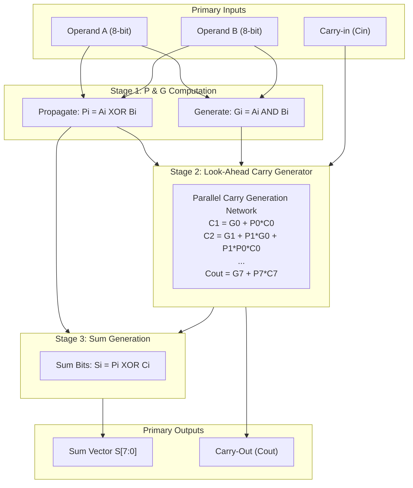

### Mathematical Formulation

For each bit position $i \in [0, 7]$:
- **Carry Generate ($G_i$):** $G_i = A_i \cdot B_i$
- **Carry Propagate ($P_i$):** $P_i = A_i \oplus B_i$
- **Carry Recurrence:** $C_{i+1} = G_i + P_i \cdot C_i$
- **Sum Bit:** $S_i = P_i \oplus C_i$

Unrolling the carry equations yields direct parallel expressions without ripple delays:

$$\begin{aligned}
C_1 &= G_0 + P_0 C_0 \\
C_2 &= G_1 + P_1 G_0 + P_1 P_0 C_0 \\
C_3 &= G_2 + P_2 G_1 + P_2 P_1 G_0 + P_2 P_1 P_0 C_0 \\
C_4 &= G_3 + P_3 G_2 + P_3 P_2 G_1 + P_3 P_2 P_1 G_0 + P_3 P_2 P_1 P_0 C_0 \\
    &\;\;\vdots \\
C_8 &= G_7 + P_7 C_7 = C_{out}
\end{aligned}$$

> **Fan-in Optimization:** To avoid excessively deep series PMOS stacks in CMOS (fan-in $\ge 5$), the 8-bit adder is partitioned into **4-bit CLA blocks** interconnected by group carry look-ahead logic.

For a complete mathematical derivation and adder comparison (RCA vs. CLA vs. CSA), see [docs/THEORY_AND_ARCHITECTURE.md](docs/THEORY_AND_ARCHITECTURE.md).

---

## 🖼️ Top-Level Design Showcase

### 1. 8-Bit Carry Look-Ahead Adder Schematic
The top-level schematic in Cadence Virtuoso Schematic Editor captures the modular interconnection of bit slices, carry look-ahead generation, and output sum buffers.

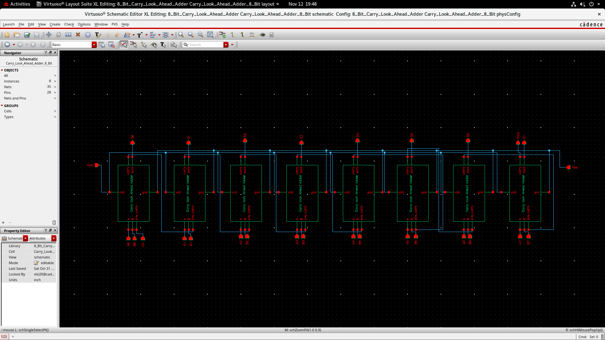

### 2. 8-Bit Carry Look-Ahead Adder Custom Layout
Full-custom physical layout designed in Cadence Virtuoso Layout XL. Layout features compact cell abutment, continuous $V_{DD}$ and $V_{SS}$ power rails on Metal1/Metal2, and symmetrical routing.

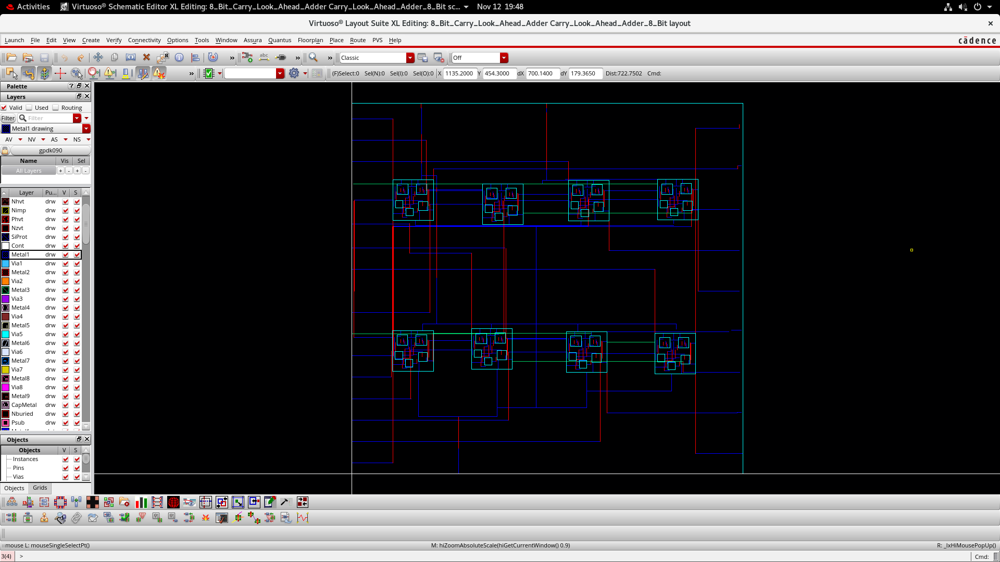

### 3. Simulation Testbench Schematic
Transient simulation testbench configured with independent pulse voltage generators (`vpulse`), DC supplies (`vdc`), and probe nets for full 17-input vector stimulation.

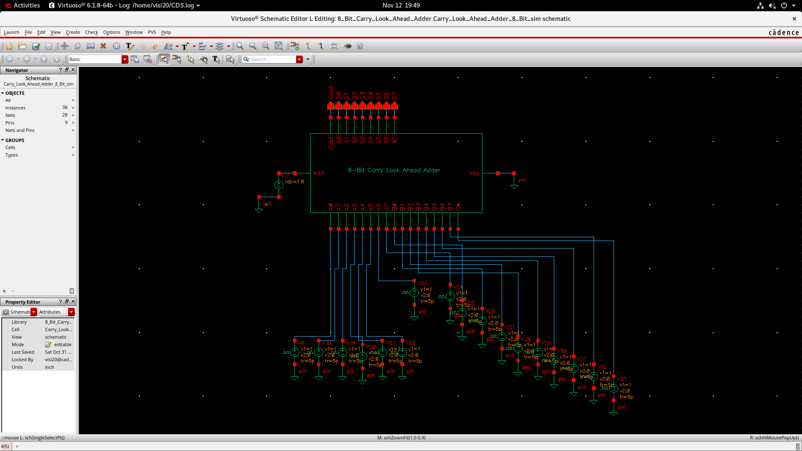

---

## 🧩 Standard Cell Library (Schematic & Layout)

All primitive standard cells were designed at the transistor level with custom layouts in Cadence 90nm GPDK:

| Gate | Schematic (Transistor Level) | Physical Layout (DRC Clean) |
| :---: | :---: | :---: |
| **2-Input AND Gate** | 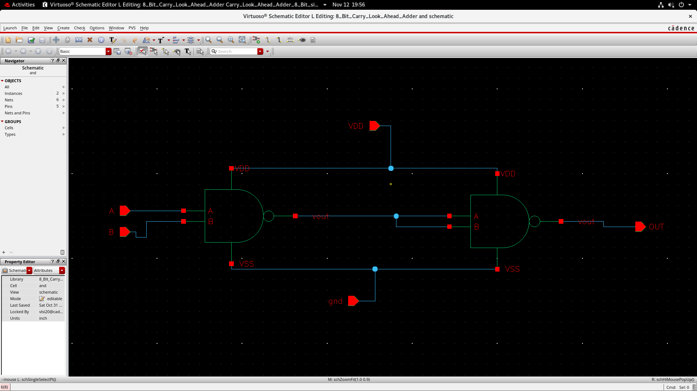 | 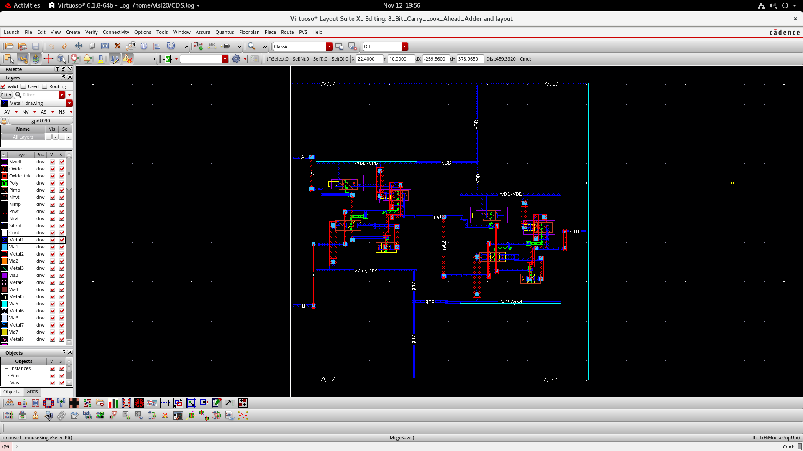 |
| **2-Input NAND Gate** | 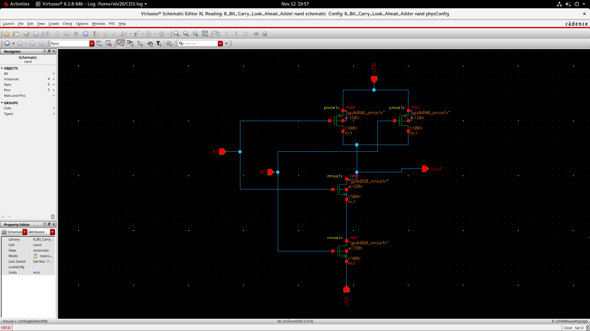 | 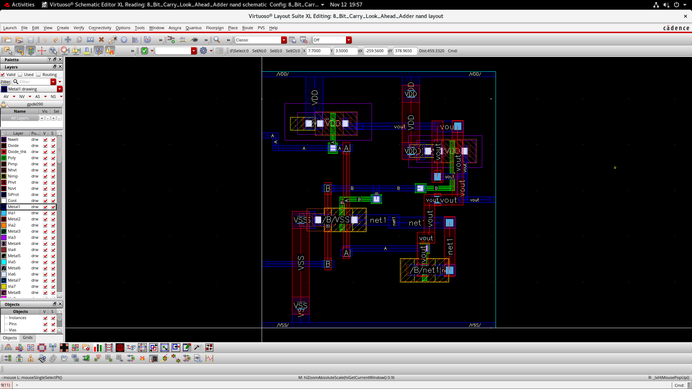 |
| **2-Input OR Gate** | 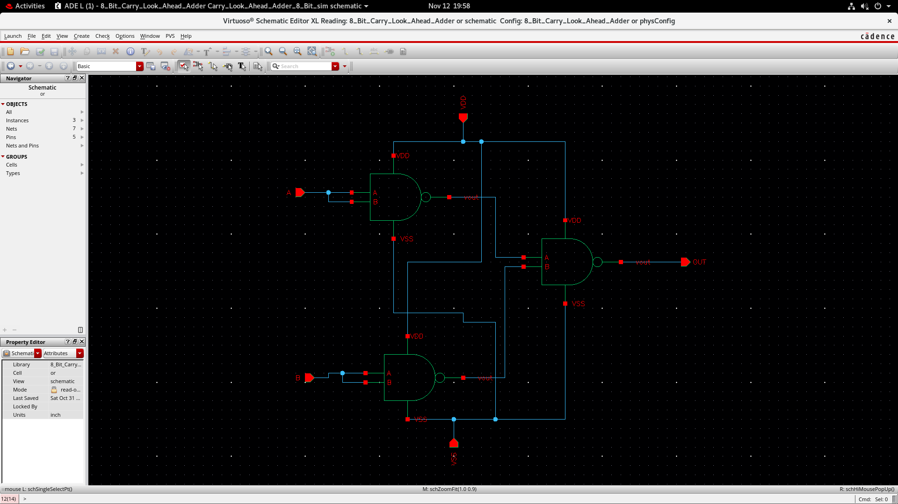 | 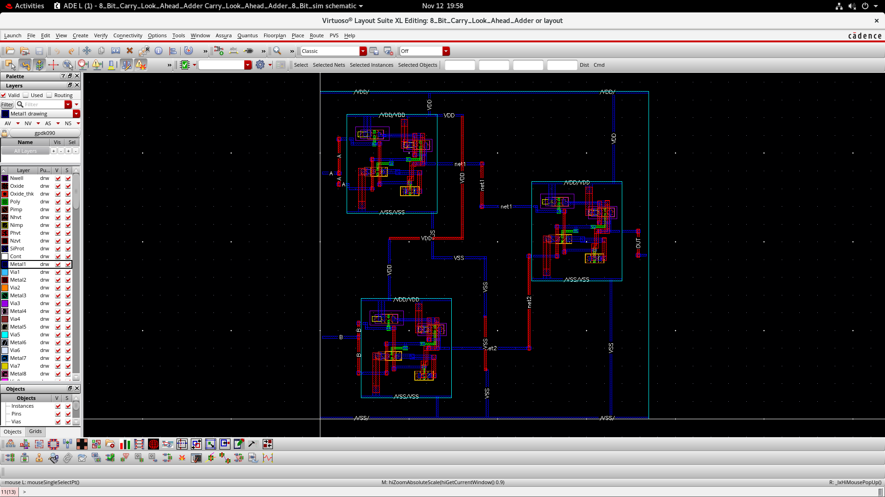 |
| **2-Input XOR Gate** | 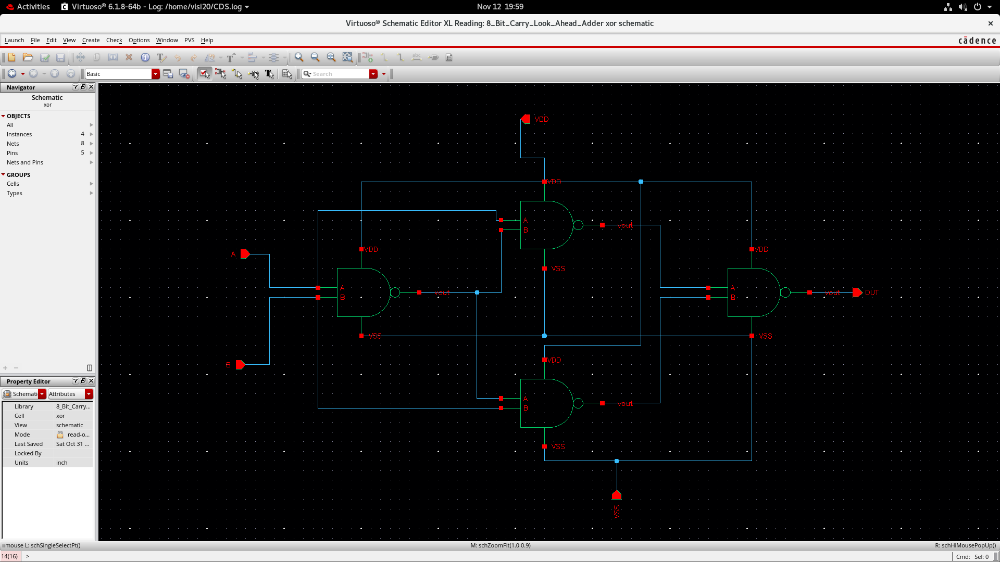 | 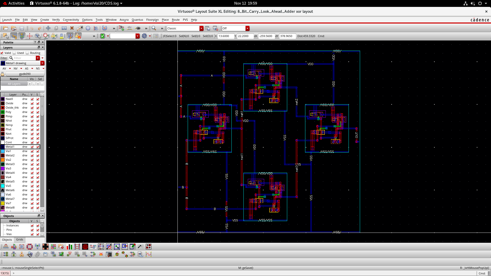 |

---

## 🚀 16-Bit CLA Extension

The modular 4-bit / 8-bit architecture was extended to a **16-Bit Carry Look-Ahead Adder**:

| 16-Bit Top-Level Schematic | 16-Bit Block Interconnect Schematic |
| :---: | :---: |
| 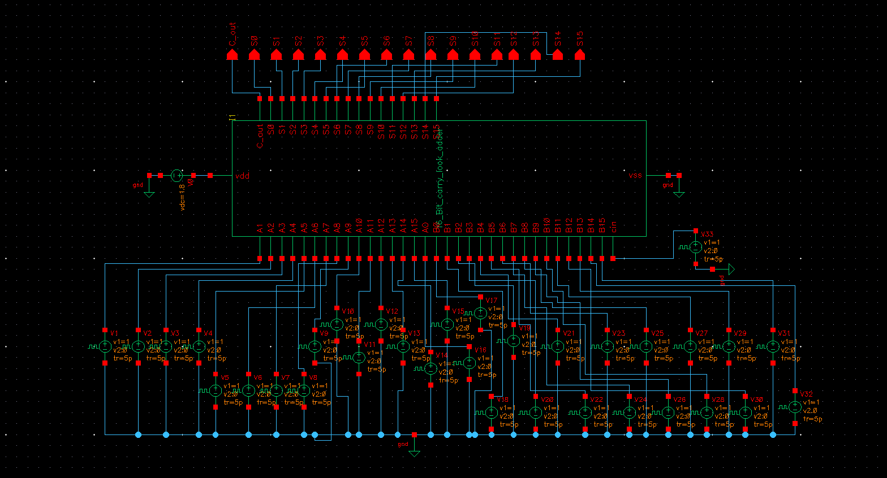 | 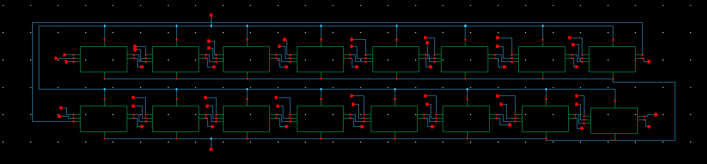 |

---

## 📈 Transient Simulation & Waveform Verification

Simulations were performed in **Cadence Spectre** over a 100 ns window with dynamic input vectors.

### Waveform Visualizations (Cadence ViVA)

| Transient Response - Output Vectors | Multi-Signal Timing Verification |
| :---: | :---: |
| 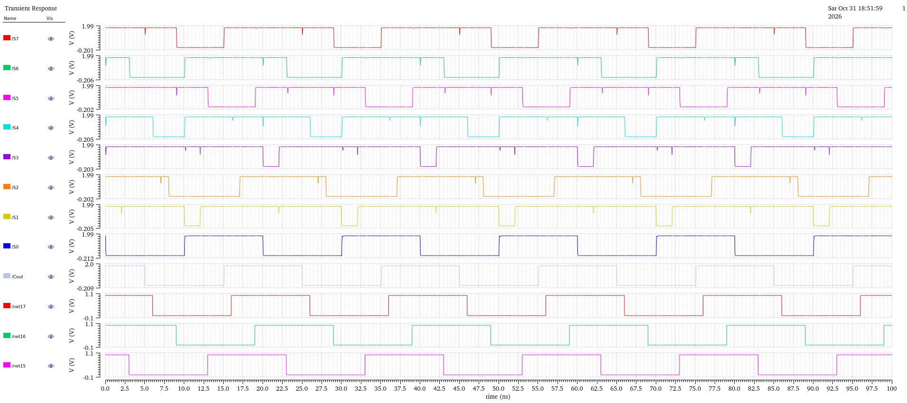 | 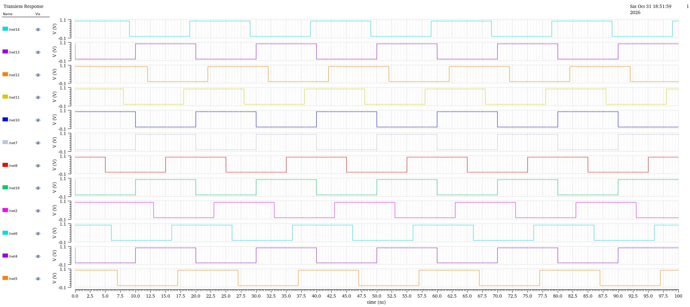 |

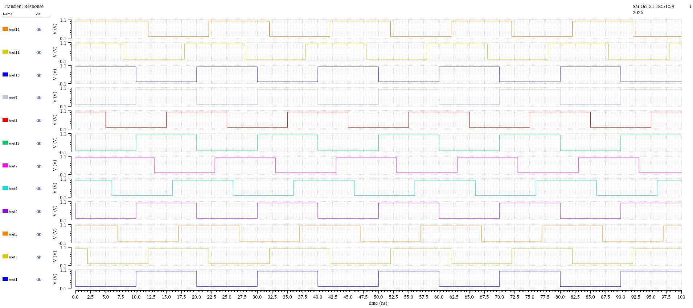

### Automated Testbench Verification Results

An automated Python analysis tool (`simulations/verify_simulation.py`) parses the raw Spectre transient CSV dataset (`simulations/8_Bit_CLA_CSA.csv`) and validates functional correctness across every switching cycle:

```
======================================================================
 TRANSIENT TIMING ANALYSIS (CADENCE SPECTRE 90nm GPDK)
======================================================================
 -> Cout Rise Time (10% to 90%):       20.08 ps
 -> Cout 50% Threshold Crossing Time:  15.105 ns
 -> Cout Fall Time (90% to 10%):       13.34 ps
 -> Nominal Supply Voltage (VDD):       1.80 V
 -> Operating Frequency:               100.0 MHz (10 ns clock period)

======================================================================
 8-BIT CLA LOGIC VERIFICATION TABLE (SPECTRE SIMULATION)
======================================================================
Time     | Cout  | S7 S6 S5 S4 S3 S2 S1 S0   | Sum (Hex)  | Status  
----------------------------------------------------------------------
  5.0 ns | 1     | 1  0  1  1  1  1  1  0    | 0x1BE      | PASSED
 15.0 ns | 0     | 0  1  0  1  1  0  1  1    | 0x05B      | PASSED
 25.0 ns | 1     | 1  0  1  1  1  1  1  0    | 0x1BE      | PASSED
 35.0 ns | 0     | 0  1  0  1  1  0  1  1    | 0x05B      | PASSED
 45.0 ns | 1     | 1  0  1  1  1  1  1  0    | 0x1BE      | PASSED
 55.0 ns | 0     | 0  1  0  1  1  0  1  1    | 0x05B      | PASSED
 65.0 ns | 1     | 1  0  1  1  1  1  1  0    | 0x1BE      | PASSED
 75.0 ns | 0     | 0  1  0  1  1  0  1  1    | 0x05B      | PASSED
 85.0 ns | 1     | 1  0  1  1  1  1  1  0    | 0x1BE      | PASSED
 95.0 ns | 0     | 0  1  0  1  1  0  1  1    | 0x05B      | PASSED
======================================================================
 All simulation cycles demonstrated clean rail-to-rail voltage swings.
```

To run the verification script yourself:
```bash
python simulations/verify_simulation.py
```

---

## 🛡️ Physical Verification & DRC Signoff

Physical design rules were evaluated using **Cadence Assura Physical Verification (av4.1)** with the foundry technology rule deck (`assura_tech.lib`).

```
************************************************************************
                  Assura DRC Run Summary

Total cells checked = 2
Total rules checked = 6970
Total violations    = 0 (DRC CLEAN)

Run time =  1.00 seconds
CPU time =  0.64 seconds
VM HWM   =  3071 Mbytes
************************************************************************
```

For the comprehensive signoff report detailing layer rules, spacing, and extraction metrics, see [verification/DRC_LVS_REPORT.md](verification/DRC_LVS_REPORT.md).

---

## 📁 Repository Structure

```
.
├── README.md                          # Main project portfolio presentation
├── LICENSE                            # MIT License
├── .gitignore                         # Cadence, Assura, and build file exclusions
├── docs/
│   ├── THEORY_AND_ARCHITECTURE.md     # Detailed Boolean algebra, carry look-ahead theory & comparison
│   ├── CADENCE_TOOL_FLOW_GUIDE.md     # Step-by-step EDA guide for Cadence Virtuoso & Assura
│   └── GITHUB_PROFILE_SNIPPET.md      # Ready-to-use profile card for personal GitHub README
├── media/
│   ├── schematics/                    # High-resolution schematic screenshots (8-bit, 16-bit, gates)
│   ├── layouts/                       # High-resolution custom layouts (8-bit CLA, AND, NAND, OR, XOR)
│   ├── waveforms/                     # Cadence ViVA transient simulation waveform screenshots
│   └── documents/                     # Cadence ViVA waveform vector prints (PDF)
├── cadence/
│   ├── cds.lib                        # Cadence library definition file
│   ├── 8_Bit_Carry_Look_Ahead_Adder/  # OpenAccess design library for 8-bit CLA & gates
│   └── 16_Bit_Carry_Look_Ahead_Adder/ # OpenAccess design library for 16-bit CLA extension
├── simulations/
│   ├── 8_Bit_CLA_CSA.csv              # Raw Spectre transient simulation dataset (0 - 100 ns)
│   └── verify_simulation.py           # Automated timing & truth table verification script
└── verification/
    ├── DRC_LVS_REPORT.md              # Formal physical verification signoff report
    └── assura_reports/                # Archived Assura DRC/LVS summary reports & logs
```

---

## ⚡ Quickstart & Reproduction Guide

### 1. Clone the Repository
```bash
git clone https://github.com/<your-username>/8-Bit-Carry-Look-Ahead-Adder-Cadence-90nm.git
cd 8-Bit-Carry-Look-Ahead-Adder-Cadence-90nm
```

### 2. Verify Simulation Data
You can verify the simulation results without Cadence installed using Python 3:
```bash
python simulations/verify_simulation.py
```

### 3. Open in Cadence Virtuoso
1. Navigate to the `cadence/` directory:
   ```bash
   cd cadence
   ```
2. Ensure your local `cds.lib` paths point to your local GPDK90 and Assura installations (see [docs/CADENCE_TOOL_FLOW_GUIDE.md](docs/CADENCE_TOOL_FLOW_GUIDE.md)).
3. Launch Cadence Virtuoso:
   ```bash
   virtuoso &
   ```
4. Open Library `8_Bit_Carry_Look_Ahead_Adder` -> Cell `Carry_Look_Ahead_Adder_8_Bit` -> View `schematic` or `layout`.

---

## 👤 Author & Acknowledgments

- **Designer:** VLSI Design Engineer
- **Tools:** Cadence Virtuoso (Schematic L, Layout XL), Spectre Simulation, Cadence Assura, ViVA
- **Technology:** Cadence Generic Process Design Kit 90nm (`gpdk090`)

If you find this project helpful for your studies or portfolio, please consider starring ⭐ this repository!
