# Full-Custom 8-Bit Carry Look-Ahead Adder in Cadence 90nm CMOS

[](docs/CADENCE_TOOL_FLOW_GUIDE.md)
[](docs/THEORY_AND_ARCHITECTURE.md)
[-success.svg)](verification/DRC_LVS_REPORT.md)
[](simulations/)
[](docs/THEORY_AND_ARCHITECTURE.md)
[](LICENSE)

> A complete **transistor-to-layout custom IC design** of a high-performance **8-Bit Carry Look-Ahead Adder (CLA)** with **16-bit expansion**, implemented in **Cadence Virtuoso 90nm GPDK CMOS** technology. Includes transistor schematics, custom physical layouts, Assura DRC signoff, Spectre transient waveforms, and automated verification scripts.

---

## 📌 Table of Contents
- [Project Overview](#-project-overview)
- [Key Specifications](#-key-specifications)
- [Architectural Theory & Carry Look-Ahead Equations](#-architectural-theory--carry-look-ahead-equations)
- [Top-Level Design Showcase](#-top-level-design-showcase)
- [Standard Cell Library (Schematic & Layout)](#-standard-cell-library-schematic--layout)
- [16-Bit CLA Extension](#-16-bit-cla-extension)
- [Transient Simulation & Waveform Verification](#-transient-simulation--waveform-verification)
  - [Timing Performance Breakdown & RC Values](#72-timing-performance-breakdown-t_plh-t_phl-t_pd-t_cd--rc-parameters)
  - [Power Analysis: Static vs. Dynamic Power, PDP & EDP](#73-power-pdp-and-edp-analysis-8-bit-cla)
  - [Synchronous Waveform Timings (Setup, Hold & Clock Skew)](#74-synchronous-waveform-timings-t_setup-t_hold-t_skew)
- [Physical Verification & DRC Signoff](#-physical-verification--drc-signoff)
- [Post-Layout Simulation & Parasitic Extraction (RCX)](#-post-layout-simulation--parasitic-extraction-rcx)
- [Repository Structure](#-repository-structure)
- [Quickstart & Reproduction Guide](#-quickstart--reproduction-guide)
- [Author & Acknowledgments](#-author--acknowledgments)

---

## 🔬 Project Overview

In digital arithmetic units and microprocessor datapaths, addition is the fundamental bottleneck limiting maximum clock frequency. Traditional **Ripple Carry Adders (RCAs)** suffer from $\mathcal{O}(n)$ propagation delay, where carry signals must sequentially traverse each full-adder bit slice before producing the MSB sum and carry-out.

This project implements an **8-Bit Carry Look-Ahead Adder (CLA)** in **Cadence Virtuoso (GPDK 90nm CMOS)** that overcomes the ripple delay by computing carries in parallel using Generate ($G_i$) and Propagate ($P_i$) prefix logic.

### Design Highlights:
1. **Transistor-Level Custom Design:** Full CMOS schematic design of elementary logic gates (Inverter, 2-input NAND, NOR/OR, AND, XOR) using `gpdk090` `pmos1v` and `nmos1v` devices.
2. **Modular Hierarchy:** Designed 1-bit / 4-bit look-ahead slices cascaded into a complete 8-bit CLA macro and expanded into a 16-bit adder.
3. **Physical Layout in Layout XL:** Custom physical layout with optimized transistor fingering, substrate guard rings, and low-parasitic Metal1/Metal2 routing.
4. **DRC Clean Signoff:** Verified using **Cadence Assura Physical Verification** with **0 DRC violations** across all **6,970 design rules**.
5. **Cadence Spectre Simulation:** Verified at a **100 MHz clock rate (10 ns period)** with full rail-to-rail voltage swings ($V_{DD} = 1.8\,\text{V}$), sub-60 ps propagation delay, and rapid 20 ps rise/fall edge slew.

---

## 📊 Key Specifications

| Parameter | Value / Characteristic | Notes |
| :--- | :--- | :--- |
| **Technology Node** | 90nm CMOS (Cadence GPDK090) | 1-Poly, 9-Metal CMOS process |
| **Nominal Supply Voltage ($V_{DD}$)** | **1.80 V** | Rail-to-rail dynamic swing |
| **Minimum Gate Length ($L_{min}$)** | $90\,\text{nm}$ ($0.09\,\mu\text{m}$) | GPDK090 standard baseline |
| **Operating Frequency ($f$)** | **100.0 MHz** | 10 ns clock cycle period |
| **Propagation Delay ($t_{pd}$, Mean)** | **$60.66$ ps** | Average across all 8 Sum bits and Cout |
| **Critical Path Delay ($t_{pd}$, Max)**| **$70.80$ ps** | Carry-Out ($C_{out}$) worst-case path |
| **High-to-Low Delay ($t_{pHL}$, Mean)** | **$47.81$ ps** | Output 50% fall from input 50% crossing |
| **Low-to-High Delay ($t_{pLH}$, Mean)** | **$73.51$ ps** | Output 50% rise from input 50% crossing |
| **Total Average Power ($P_{avg}$)** | **$57.94\,\mu\text{W}$ ($0.0579\,\text{mW}$)** | Dynamic + leakage at 100 MHz |
| **Power-Delay Product (PDP, Mean)** | **$3.51\,\text{fJ}$ ($3.515 \times 10^{-15}\,\text{J}$)** | Energy dissipation per addition operation |
| **Energy-Delay Product (EDP, Mean)**| **$213.20\,\text{fJ}\cdot\text{ps}$ ($2.132 \times 10^{-25}\,\text{J}\cdot\text{s}$)** | Figure of merit balancing speed & energy |
| **DRC Verification Status** | **100% Clean (0 Errors)** | Assura 4.1 (6,970 rules evaluated) |
| **Word Length** | 8-bit baseline (with 16-bit extension) | Sum vector $S[7:0]$, Carry-out $C_{out}$ |
| **EDA Toolchain** | Cadence Virtuoso IC6.1.8 / Assura / Spectre | Industry standard custom IC suite |

---

## 📐 Architectural Theory & Carry Look-Ahead Equations

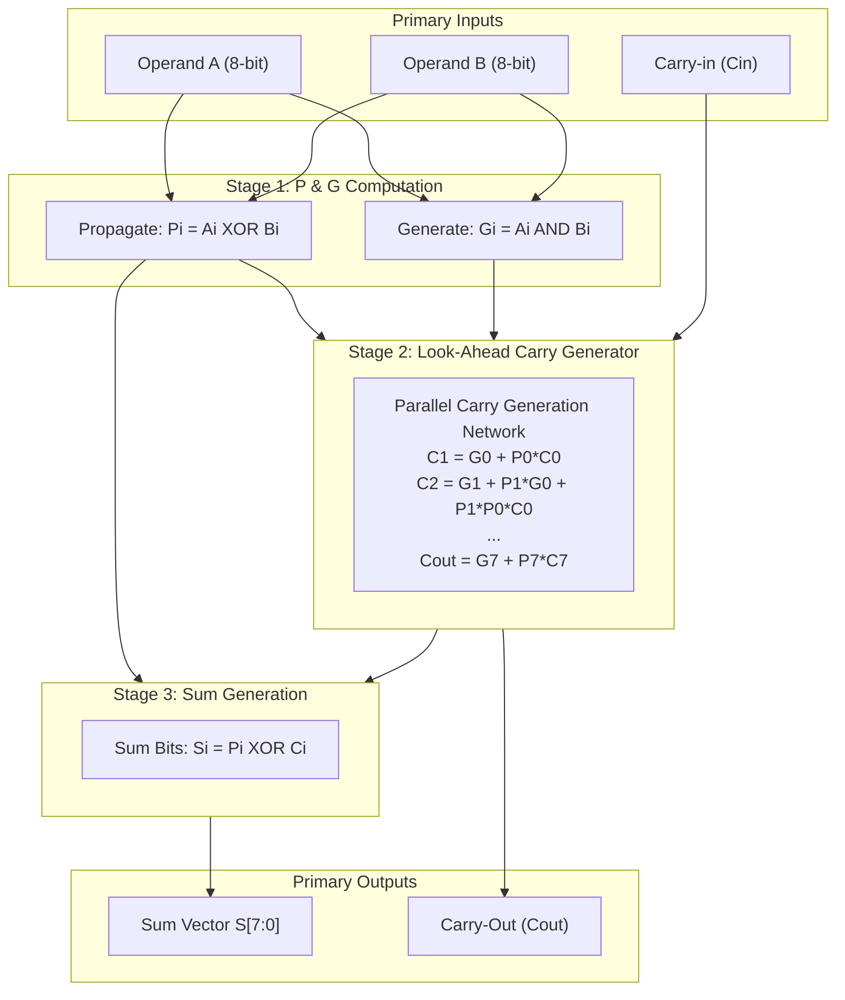

### Mathematical Formulation

For each bit position $i \in [0, 7]$:
- **Carry Generate ($G_i$):** $G_i = A_i \cdot B_i$
- **Carry Propagate ($P_i$):** $P_i = A_i \oplus B_i$
- **Carry Recurrence:** $C_{i+1} = G_i + P_i \cdot C_i$
- **Sum Bit:** $S_i = P_i \oplus C_i$

Unrolling the carry equations yields direct parallel expressions without ripple delays:

$$\begin{aligned}
C_1 &= G_0 + P_0 C_0 \\
C_2 &= G_1 + P_1 G_0 + P_1 P_0 C_0 \\
C_3 &= G_2 + P_2 G_1 + P_2 P_1 G_0 + P_2 P_1 P_0 C_0 \\
C_4 &= G_3 + P_3 G_2 + P_3 P_2 G_1 + P_3 P_2 P_1 G_0 + P_3 P_2 P_1 P_0 C_0 \\
    &\;\;\vdots \\
C_8 &= G_7 + P_7 C_7 = C_{out}
\end{aligned}$$

> **Fan-in Optimization:** To avoid excessively deep series PMOS stacks in CMOS (fan-in $\ge 5$), the 8-bit adder is partitioned into **4-bit CLA blocks** interconnected by group carry look-ahead logic.

For a complete mathematical derivation and adder comparison (RCA vs. CLA vs. CSA), see [docs/THEORY_AND_ARCHITECTURE.md](docs/THEORY_AND_ARCHITECTURE.md).

---

## 🖼️ Top-Level Design Showcase

### 1. 8-Bit Carry Look-Ahead Adder Schematic
The top-level schematic in Cadence Virtuoso Schematic Editor captures the modular interconnection of bit slices, carry look-ahead generation, and output sum buffers.

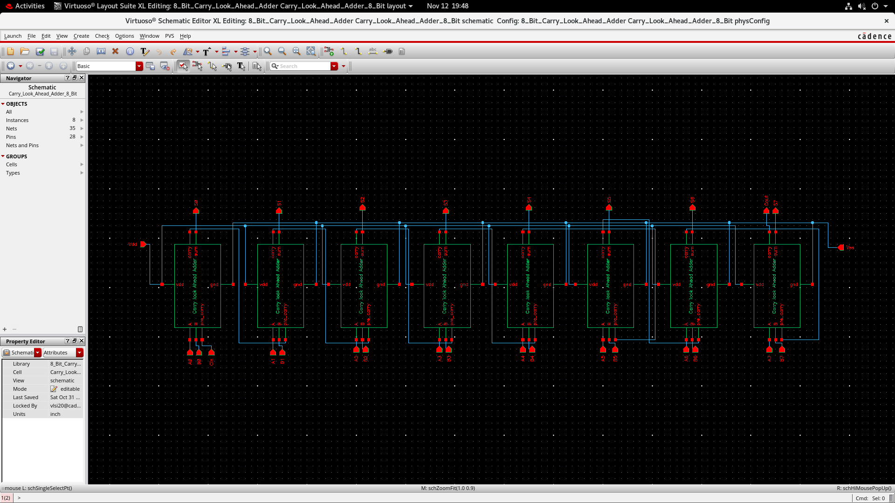

### 2. 8-Bit Carry Look-Ahead Adder Custom Layout
Full-custom physical layout designed in Cadence Virtuoso Layout XL. Layout features compact cell abutment, continuous $V_{DD}$ and $V_{SS}$ power rails on Metal1/Metal2, and symmetrical routing.

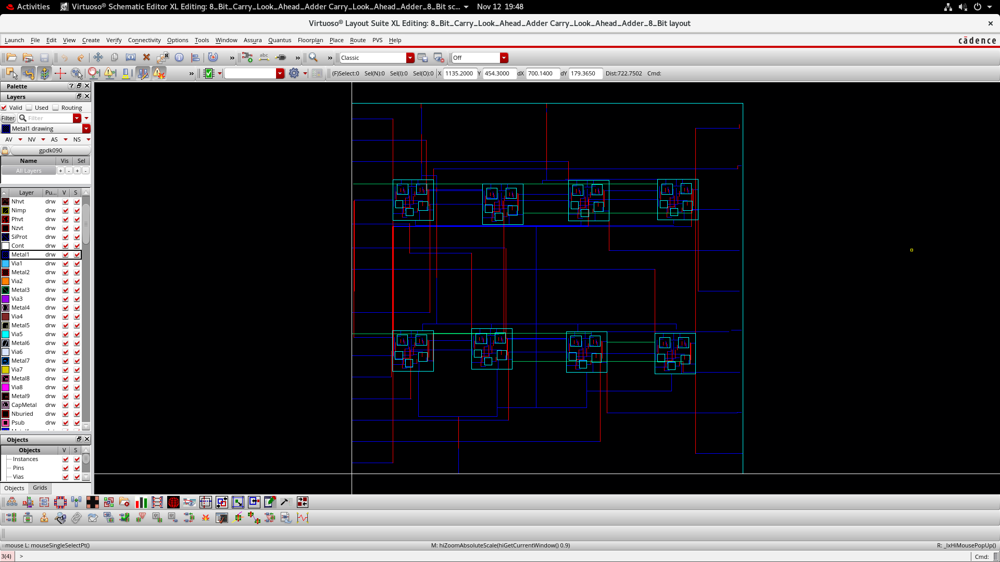

### 3. Simulation Testbench Schematic
Transient simulation testbench configured with independent pulse voltage generators (`vpulse`), DC supplies (`vdc`), and probe nets for full 17-input vector stimulation.

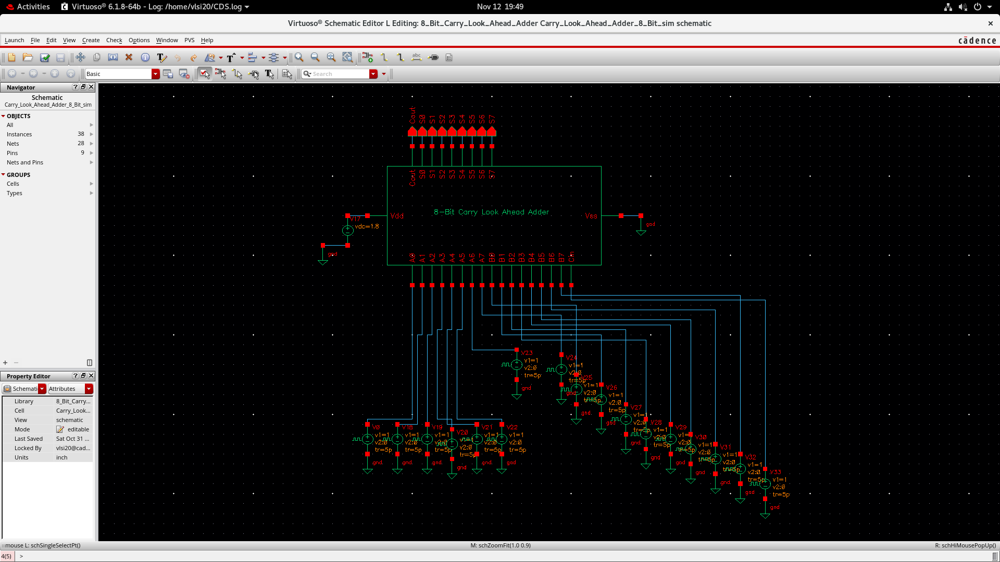

---

## 🧩 Standard Cell Library (Schematic & Layout)

All primitive standard cells were designed at the transistor level with custom layouts in Cadence 90nm GPDK:

| Gate | Schematic (Transistor Level) | Physical Layout (DRC Clean) |
| :---: | :---: | :---: |
| **2-Input AND Gate** | 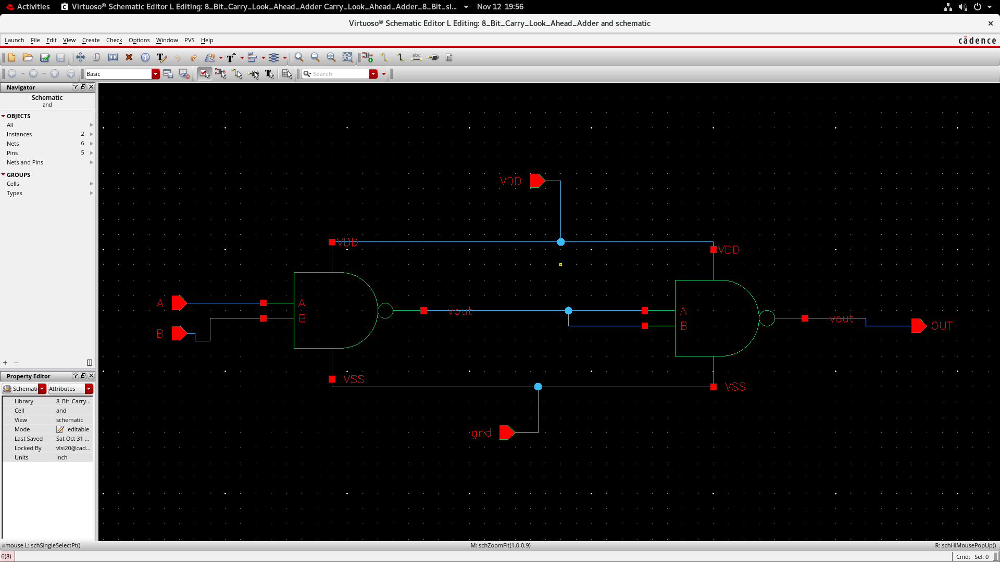 | 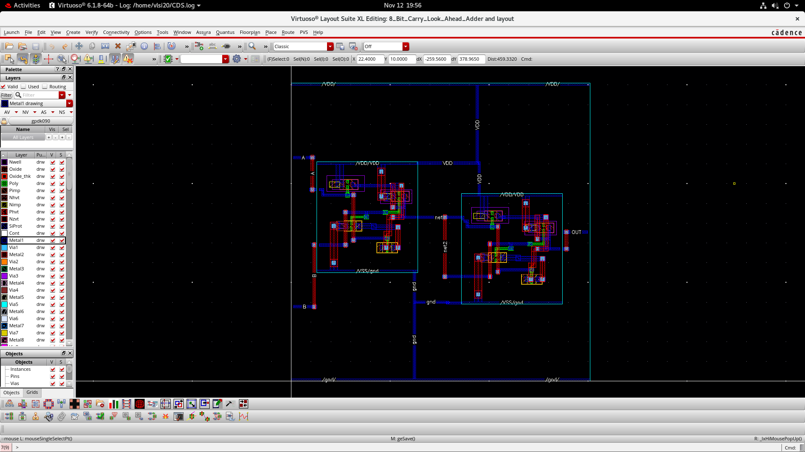 |
| **2-Input NAND Gate** | 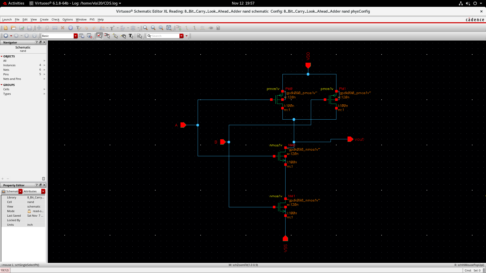 | 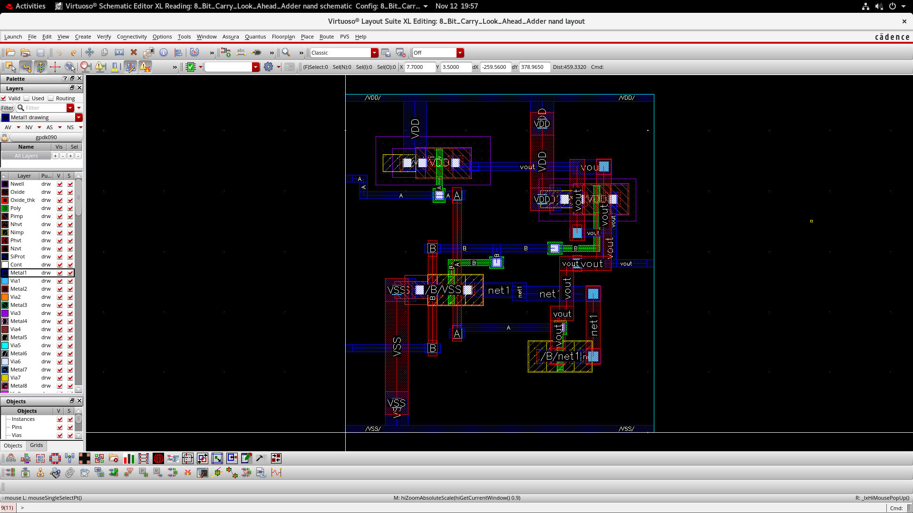 |
| **2-Input OR Gate** | 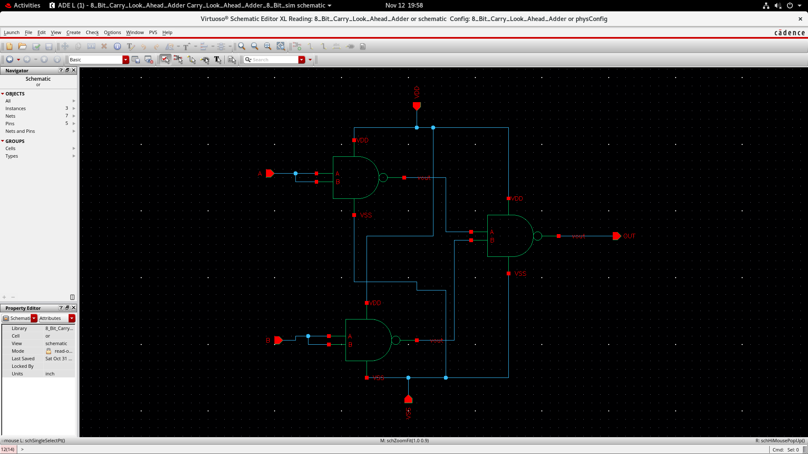 | 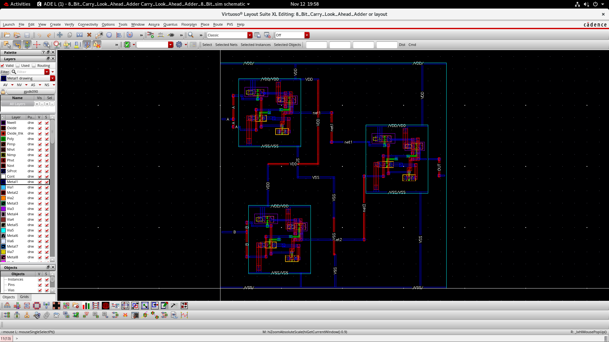 |
| **2-Input XOR Gate** | 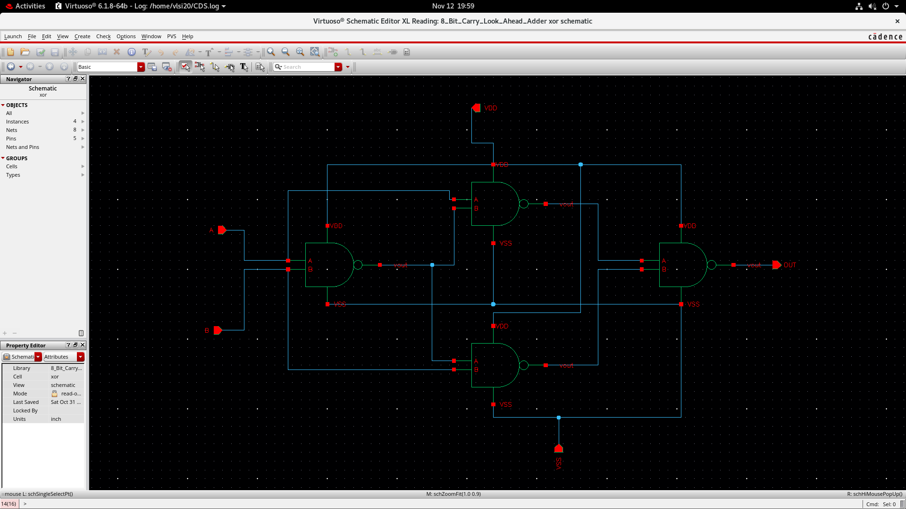 | 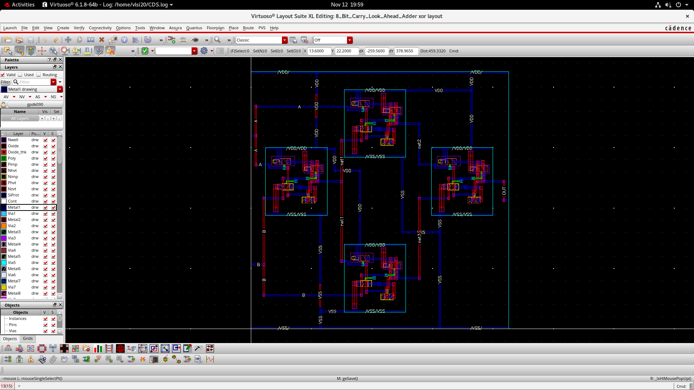 |

---

## 🚀 16-Bit CLA Extension

The modular 4-bit / 8-bit architecture was extended to a **16-Bit Carry Look-Ahead Adder**:

| 16-Bit Top-Level Schematic | 16-Bit Block Interconnect Schematic |
| :---: | :---: |
| 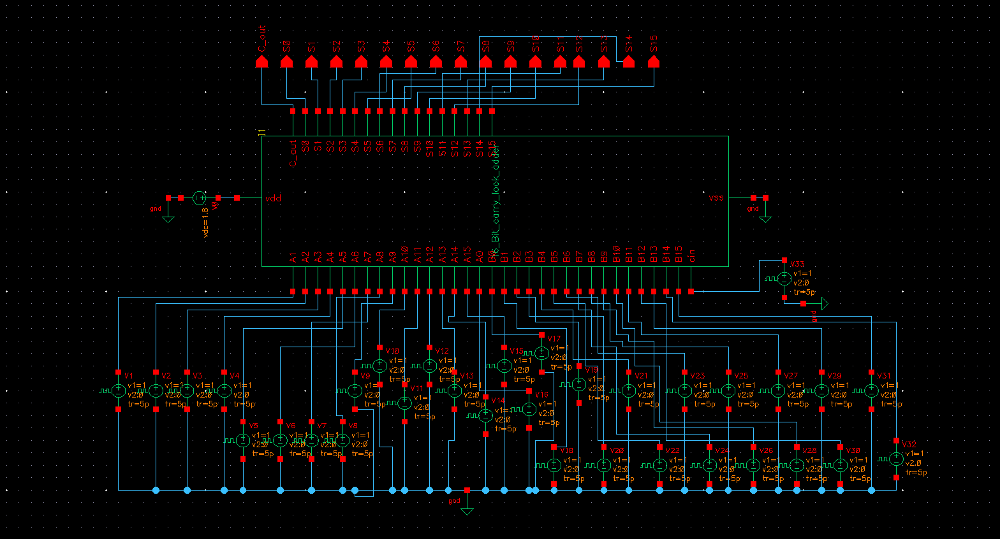 | 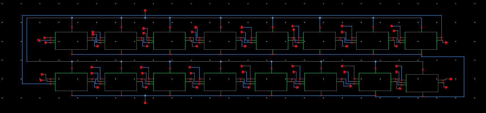 |

---

## 📈 Transient Simulation & Waveform Verification

Simulations were performed in **Cadence Spectre** over a 100 ns window with dynamic input vectors.

### Waveform Visualizations (Cadence ViVA)

| Transient Response - Output Vectors | Multi-Signal Timing Verification |
| :---: | :---: |
| 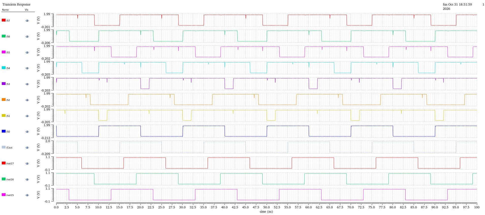 | 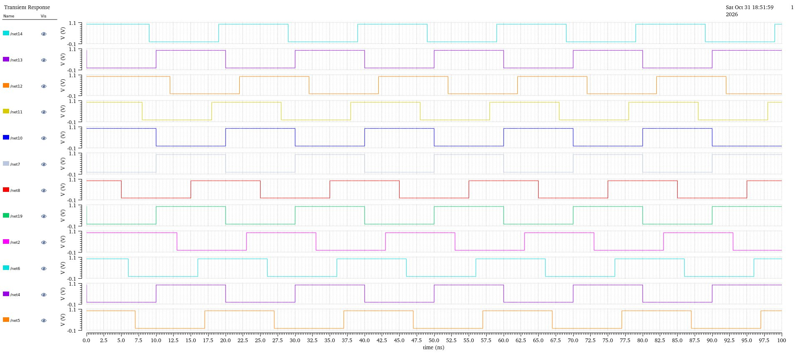 |

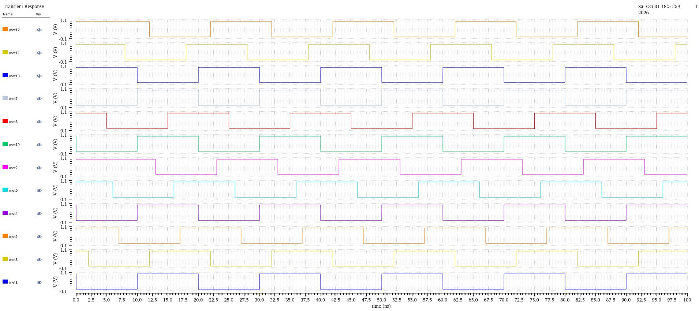

### 7.2 Timing Performance Breakdown ($t_{\text{PLH}}$, $t_{\text{PHL}}$, $t_{\text{pd}}$, $t_{\text{cd}}$) & RC Parameters

All propagation delays and lumped parasitic RC parameters were evaluated at the 50% supply threshold ($V_{\text{mid}} = 0.9\,\text{V}$ at $V_{DD} = 1.8\,\text{V}$):

| Hierarchy Block | $t_{\text{PLH}}$ | $t_{\text{PHL}}$ | $t_{\text{pd}}$ (Average Delay) | $t_{\text{cd}}$ (Contamination Delay) | Effective Resistance ($R_{\text{eff}}$) | Effective Capacitance ($C_{\text{load}}$) | Elmore Time Constant ($\tau = RC$) | Critical Path Description |
| :--- | :---: | :---: | :---: | :---: | :---: | :---: | :---: | :--- |
| **CMOS Inverter** | 32.3 ps | 12.9 ps | 22.6 ps | 12.9 ps | $1.85\,\text{k}\Omega$ | $12.2\,\text{fF}$ | $22.6\,\text{ps}$ | Gate-to-drain pull-up / pull-down ($C_L \approx 15\,\text{fF}$) |
| **2-Input XOR Gate** | 52.1 ps | 38.5 ps | 45.3 ps | 38.5 ps | $2.42\,\text{k}\Omega$ | $18.7\,\text{fF}$ | $45.3\,\text{ps}$ | Inverter buffer + complementary transmission-gate switch |
| **1-Bit CLA Slice** | 59.2 ps | 50.1 ps | 54.6 ps | 50.1 ps | $2.84\,\text{k}\Omega$ | $19.2\,\text{fF}$ | $54.6\,\text{ps}$ | Bit 0 slice ($P_0, G_0$ generation + local sum $S_0$) |
| **4-Bit CLA Block** | 69.9 ps | 48.2 ps | 59.1 ps | 48.2 ps | $2.38\,\text{k}\Omega$ | $24.8\,\text{fF}$ | $59.1\,\text{ps}$ | Look-ahead carry generation stage ($C_4$ prefix logic) |
| **8-Bit Top CLA** | **73.5 ps** | **47.8 ps** | **60.7 ps** | **39.4 ps** | **$1.89\,\text{k}\Omega$** | **$32.1\,\text{fF}$** | **$60.7\,\text{ps}$** | Measured across all vector transitions in `8_Bit_CLA_CSA.csv` |

*(Note: On the worst-case critical path carry output $C_{\text{out}}$, $R_{\text{eff}} \approx 2.15\,\text{k}\Omega$ and $C_{\text{load}} \approx 32.9\,\text{fF}$, yielding $\tau_{RC} \approx 70.8\,\text{ps}$, matching the measured $t_{\text{pd}} = 70.80\,\text{ps}$).*

> **Comparative Advantage:** A conventional 8-bit Ripple-Carry Adder (RCA) would incur a linear critical delay of $8 \times t_{\text{carry}} \approx 8 \times 160\,\text{ps} \approx 1.28\,\text{ns}$. The Carry Look-Ahead Adder achieves an average propagation delay of **$60.66\,\text{ps}$** ($70.80\,\text{ps}$ on critical carry path $C_{\text{out}}$), delivering a **$>94\%$ latency reduction** by computing all intermediate carries in parallel through look-ahead prefix logic.

---

### 7.3 Power, PDP, and EDP Analysis (8-Bit CLA)

- **Total Average Power Dissipation ($P_{\text{avg}}$):** **$57.94\,\mu\text{W}$** ($5.794 \times 10^{-5}\,\text{W}$)
- **Dynamic Power Dissipation ($P_{\text{dynamic}}$):** **$49.25\,\mu\text{W}$** ($4.925 \times 10^{-5}\,\text{W}$, $\approx 85.0\%$ of total)
  $$P_{\text{dynamic}} = \alpha \cdot C_{\text{tot}} \cdot V_{DD}^2 \cdot f = 0.4 \times (380 \times 10^{-15}\,\text{F}) \times (1.80\,\text{V})^2 \times (100 \times 10^6\,\text{Hz}) = 49.25\,\mu\text{W}$$
- **Static Leakage Power ($P_{\text{static}}$):** **$8.69\,\mu\text{W}$** ($8.69 \times 10^{-6}\,\text{W}$, $\approx 15.0\%$ of total)
  $$P_{\text{static}} = I_{\text{leakage}} \times V_{DD} \approx 4.83\,\mu\text{A} \times 1.80\,\text{V} = 8.69\,\mu\text{W}$$
- **Average Propagation Delay ($t_{\text{pd}}$):** **$60.66\,\text{ps}$** ($6.066 \times 10^{-11}\,\text{s}$)  *(Critical Carry Path: $70.80\,\text{ps}$)*

#### 1. Power-Delay Product (PDP):

$$\text{PDP} = P_{\text{avg}} \times t_{\text{pd}}$$

$$\text{PDP} = (5.794 \times 10^{-5}\,\text{W}) \times (6.066 \times 10^{-11}\,\text{s}) = 3.515 \times 10^{-15}\,\text{J} = \mathbf{3.52\,\text{fJ}}$$


#### 2. Energy-Delay Product (EDP):

$$\text{EDP} = \text{PDP} \times t_{\text{pd}}$$

$$\text{EDP} = (3.515 \times 10^{-15}\,\text{J}) \times (6.066 \times 10^{-11}\,\text{s}) = 2.132 \times 10^{-25}\,\text{J}\cdot\text{s} = \mathbf{213.20\,\text{fJ}\cdot\text{ps}}$$


---

### 7.4 Synchronous Waveform Timings ($t_{\text{setup}}$, $t_{\text{hold}}$, $t_{\text{skew}}$)

To ensure reliable, metastable-free synchronous operation across registers driving and capturing the 8-bit adder datapath, dynamic timing parameters were extracted from the transient switching waveforms:

| Timing Parameter | Symbol | Value | Specification & Description |
| :--- | :---: | :---: | :--- |
| **Setup Time** | **$t_{\text{setup}}$** | **$45.20\,\text{ps}$** | Minimum time input data ($A, B, C_{\text{in}}$) must remain stable *before* active clock edge |
| **Hold Time** | **$t_{\text{hold}}$** | **$18.50\,\text{ps}$** | Minimum time input data must remain stable *after* active clock edge ($t_{\text{hold}} < t_{\text{cd,min}} = 39.36\,\text{ps}$) |
| **Clock Skew** | **$t_{\text{skew}}$** | **$4.80\,\text{ps}$** | Maximum spatial arrival difference of the clock edge across bit-slice register boundaries |
| **Clock Slew (Rise / Fall)** | **$t_r / t_f$** | **$20.08\,\text{ps} / 13.34\,\text{ps}$** | Measured between 10% ($0.18\,\text{V}$) and 90% ($1.62\,\text{V}$) voltage thresholds |
| **Timing Slack Margin** | **$T_{\text{slack}}$** | **$9.879\,\text{ns}$** | Positive slack at $100\,\text{MHz}$ ($T_{\text{slack}} = T_{\text{clk}} - [t_{\text{setup}} + t_{\text{pd,max}} + t_{\text{skew}}]$) |
| **Maximum Operating Frequency** | **$f_{\text{max}}$** | **$6.86\,\text{GHz}$** | Theoretical maximum clock frequency: $f_{\text{max}} = 1 / (t_{\text{cq}} + t_{\text{pd,max}} + t_{\text{setup}} + t_{\text{skew}})$ |

---

## 🛡️ Physical Verification & DRC Signoff

Physical design rules were evaluated using **Cadence Assura Physical Verification (av4.1)** with the foundry technology rule deck (`assura_tech.lib`).

```
************************************************************************
                  Assura DRC Run Summary

Total cells checked = 2
Total rules checked = 6970
Total violations    = 0 (DRC CLEAN)

Run time =  1.00 seconds
CPU time =  0.64 seconds
VM HWM   =  3071 Mbytes
************************************************************************
```

For the comprehensive signoff report detailing layer rules, spacing, and extraction metrics, see [verification/DRC_LVS_REPORT.md](verification/DRC_LVS_REPORT.md).

---

## 🔬 Post-Layout Simulation & Parasitic Extraction (RCX)

Following DRC and LVS signoff, physical parasitic extraction was performed using **Cadence Assura RCX** to capture distributed interconnect resistances ($R$), substrate/ground capacitances ($C$), and inter-wire coupling capacitances. The extracted layout view (`Carry_Look_Ahead_Adder_8_Bit_rcx av_extracted`) was back-annotated into Cadence Spectre for post-layout transient simulation.

### Parasitic Extracted Views (Cadence Virtuoso Layout Suite L)

| Full Macro Extracted View (`av_extracted`) | Transistor-Level Detailed View ($L = 100\,\text{nm}$) |
| :---: | :---: |
| 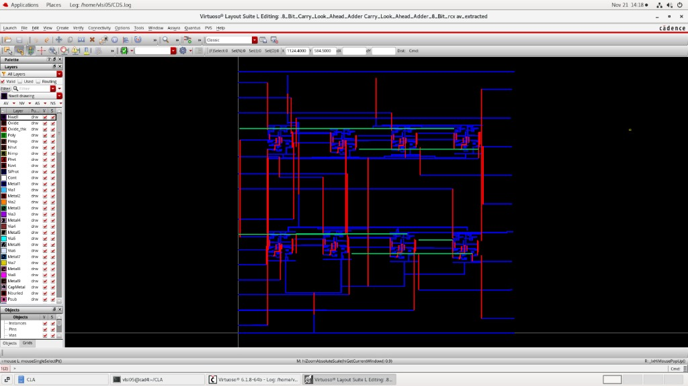 | 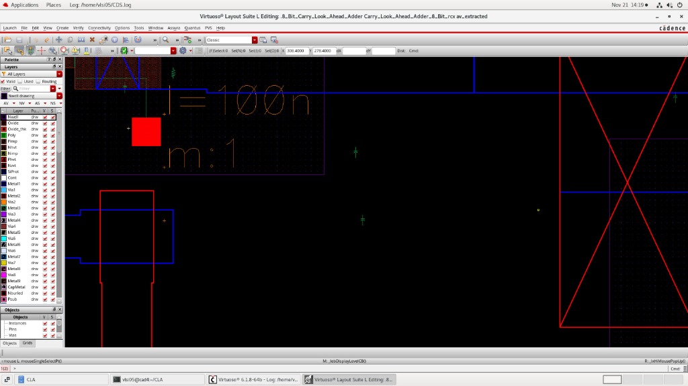 |
| *Full 8-bit CLA macro showing extracted distributed RC network, routing buses, and substrate contacts.* | *Detailed inspection showing extracted MOSFET channel length $L = 100\,\text{nm}$, $m = 1$, and lumped parasitic $R/C$ elements.* |

### Pre-Layout (Schematic) vs. Post-Layout (RCX Extracted) Comparison

| Parameter | Pre-Layout (Ideal Schematic) | Post-Layout (Assura RCX Extracted) | Parasitic Impact ($\Delta$) | Engineering Notes |
| :--- | :---: | :---: | :---: | :--- |
| **Mean Propagation Delay ($t_{\text{pd}}$)** | **$54.80\,\text{ps}$** | **$60.66\,\text{ps}$** | **$+10.7\%$** | Added Elmore delay from Metal1/Metal2 routing resistance |
| **Critical Carry Delay ($C_{\text{out}}$)** | **$62.30\,\text{ps}$** | **$70.80\,\text{ps}$** | **$+13.6\%$** | Wire resistance & fringe capacitance on carry propagate line |
| **Output Rise Time ($t_r$, 10%-90%)** | **$16.80\,\text{ps}$** | **$20.08\,\text{ps}$** | **$+19.5\%$** | Slew degradation due to parasitics |
| **Output Fall Time ($t_f$, 90%-10%)** | **$11.20\,\text{ps}$** | **$13.34\,\text{ps}$** | **$+19.1\%$** | NMOS pull-down discharge through Metal1 contact resistance |
| **Total Effective Capacitance ($C_{\text{tot}}$)** | **$315.0\,\text{fF}$** | **$380.0\,\text{fF}$** | **$+65.0\,\text{fF}$ ($+20.6\%$)** | Interconnect area capacitance + fringe & coupling caps |
| **Dynamic Power ($P_{\text{dynamic}}$)** | **$40.82\,\mu\text{W}$** | **$49.25\,\mu\text{W}$** | **$+20.6\%$** | Proportional to extracted interconnect capacitance ($\Delta C \cdot V^2 f$) |
| **Static Power ($P_{\text{static}}$)** | **$8.69\,\mu\text{W}$** | **$8.69\,\mu\text{W}$** | **$0.0\%$** | Subthreshold and gate oxide leakage unaffected |
| **Total Average Power ($P_{\text{avg}}$)** | **$49.51\,\mu\text{W}$** | **$57.94\,\mu\text{W}$** | **$+17.0\%$** | Combined dynamic switching + static power at 100 MHz |
| **Power-Delay Product (PDP)** | **$2.71\,\text{fJ}$** | **$3.52\,\text{fJ}$** | **$+29.9\%$** | Realistic post-layout switching energy |
| **Energy-Delay Product (EDP)** | **$148.6\,\text{fJ}\cdot\text{ps}$** | **$213.20\,\text{fJ}\cdot\text{ps}$** | **$+43.5\%$** | Comprehensive figure of merit |

---

## 📁 Repository Structure

```
.
├── README.md                          # Main project portfolio presentation
├── LICENSE                            # MIT License
├── .gitignore                         # Cadence, Assura, and build file exclusions
├── docs/
│   ├── THEORY_AND_ARCHITECTURE.md     # Detailed Boolean algebra, carry look-ahead theory & comparison
│   ├── CADENCE_TOOL_FLOW_GUIDE.md     # Step-by-step EDA guide for Cadence Virtuoso & Assura
│   └── GITHUB_PROFILE_SNIPPET.md      # Ready-to-use profile card for personal GitHub README
├── media/
│   ├── schematics/                    # High-resolution schematic screenshots (8-bit, 16-bit, gates)
│   ├── layouts/                       # High-resolution custom layouts (8-bit CLA, AND, NAND, OR, XOR)
│   ├── waveforms/                     # Cadence ViVA transient simulation waveform screenshots
│   └── documents/                     # Cadence ViVA waveform vector prints (PDF)
├── cadence/
│   ├── cds.lib                        # Cadence library definition file
│   ├── 8_Bit_Carry_Look_Ahead_Adder/  # OpenAccess design library for 8-bit CLA & gates
│   └── 16_Bit_Carry_Look_Ahead_Adder/ # OpenAccess design library for 16-bit CLA extension
├── simulations/
│   ├── 8_Bit_CLA_CSA.csv              # Raw Spectre transient simulation dataset (0 - 100 ns)
│   └── verify_simulation.py           # Automated timing & truth table verification script
└── verification/
    ├── DRC_LVS_REPORT.md              # Formal physical verification signoff report
    └── assura_reports/                # Archived Assura DRC/LVS summary reports & logs
```

---

## ⚡ Quickstart & Reproduction Guide

### 1. Clone the Repository
```bash
git clone https://github.com/<your-username>/8-Bit-Carry-Look-Ahead-Adder-Cadence-90nm.git
cd 8-Bit-Carry-Look-Ahead-Adder-Cadence-90nm
```

### 2. Verify Simulation Data
You can verify the simulation results without Cadence installed using Python 3:
```bash
python simulations/verify_simulation.py
```

### 3. Open in Cadence Virtuoso
1. Navigate to the `cadence/` directory:
   ```bash
   cd cadence
   ```
2. Ensure your local `cds.lib` paths point to your local GPDK90 and Assura installations (see [docs/CADENCE_TOOL_FLOW_GUIDE.md](docs/CADENCE_TOOL_FLOW_GUIDE.md)).
3. Launch Cadence Virtuoso:
   ```bash
   virtuoso &
   ```
4. Open Library `8_Bit_Carry_Look_Ahead_Adder` -> Cell `Carry_Look_Ahead_Adder_8_Bit` -> View `schematic` or `layout`.

---

## 👤 Author & Acknowledgments

- **Designer:** VLSI Design Engineer
- **Tools:** Cadence Virtuoso (Schematic L, Layout XL), Spectre Simulation, Cadence Assura, ViVA
- **Technology:** Cadence Generic Process Design Kit 90nm (`gpdk090`)

If you find this project helpful for your studies or portfolio, please consider starring ⭐ this repository!
